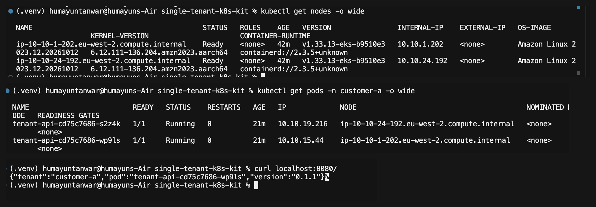
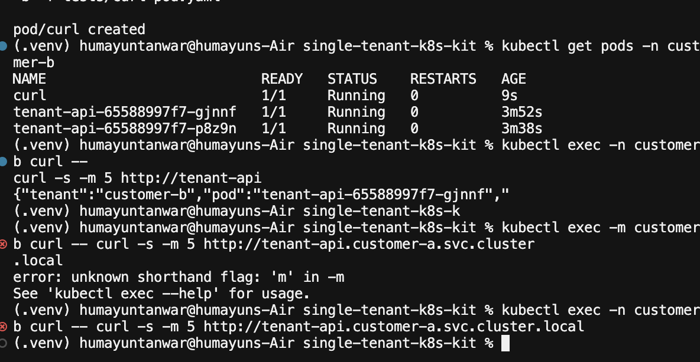
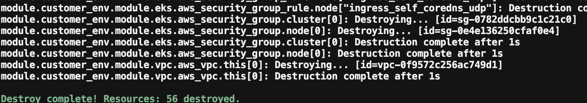
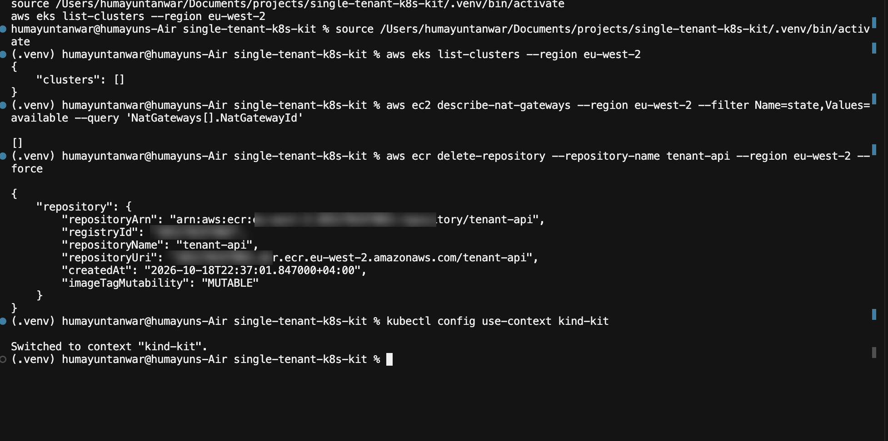
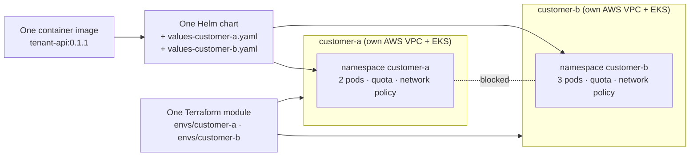

# single-tenant-k8s-kit

One application, deployed as a **separate, isolated environment for each customer**: its own network, its own Kubernetes cluster, and its own settings. It's built from **one container image, one Helm chart and one Terraform module**.

I built it by hand over one weekend, to learn how a single-tenant product is deployed into a customer's cloud. I ran it locally on Kubernetes, proved customers are isolated from each other, then deployed it to **AWS EKS in London** and tore it down cleanly.

---

## At a glance

| | |
|---|---|
| **Runs on AWS** | Terraform built a private VPC and EKS cluster (56 resources). The Helm chart deployed the app, which answered from private nodes in two availability zones. Everything was then destroyed and verified empty. |
| **Customers are isolated** | customer-b cannot reach customer-a. Default-deny network policies enforced by the CNI. |
| **Locked down by default** | Non-root containers, read-only filesystem, Pod Security `restricted`, per-customer quotas, no public endpoints. |
| **Every claim is tested** | 23 tests on purpose: failures, bad releases, isolation, security controls. See [`docs/TESTS.md`](docs/TESTS.md). |
| **Every choice is explained** | Each design decision and the reason for it: [`DECISIONS.md`](DECISIONS.md). |

---

## Proof

**Running on AWS EKS (eu-west-2):** two private Graviton nodes (no external IPs, two zones), the app's pods spread across them, and a live response from `customer-a`.



**Customer isolation:** from inside customer-b, a call to its own service works; a call to customer-a's service times out (exit code 28).



**Clean teardown:** `Destroy complete! Resources: 56 destroyed.`, then no clusters, no NAT gateways, and the registry deleted.




---

## How it works



- **The same code for everyone.** One image, so every customer runs the same tested build. Customers differ only in settings.
- **Helm** turns one set of templates into each customer's environment. A new customer is one small values file.
- **Terraform** builds each customer's cloud: a private VPC across two zones and an EKS cluster with nodes only in private subnets. A new customer is one small folder. Full design: [`docs/AWS-ARCHITECTURE.md`](docs/AWS-ARCHITECTURE.md).

---

## Tech used

| Tool | Version | Used for |
|---|---|---|
| Python + FastAPI | 3.12 | The small API being deployed |
| Docker (OrbStack) | 29.8 | Two-stage, non-root image |
| kind | 0.33 | Local 3-node Kubernetes cluster |
| Kubernetes | 1.37 local · 1.33 on EKS | Deployments, Services, NetworkPolicy, Pod Security, quotas |
| Calico | 3.33 | Local CNI that enforces NetworkPolicy |
| Helm | 4.3 | One chart, per-customer values, schema validation |
| Terraform | 1.16 | VPC + EKS module per customer |
| AWS | eu-west-2 | VPC, EKS, Graviton (ARM) nodes, ECR, KMS, CloudWatch, IAM |

---

## What I built, step by step

Each phase is a commit you can browse in the history.

1. **App and container.** A small FastAPI service with liveness and readiness checks, and settings from environment variables. Built as a two-stage image running as uid 10001, never root, with a version tag, never `latest`.
2. **Kubernetes basics, then broke it.** On a local kind cluster with Calico: killed pods, crashed the process, shipped a bad image, broke readiness and drained a node. The service stayed up every time. Released a bug fix as `0.1.1` with a zero-downtime rolling update.
3. **Two isolated customers.** A namespace per customer, plus default-deny network policies, Pod Security `restricted`, quotas, and secrets mounted as files. Proved cross-customer traffic is blocked and root pods are refused.
4. **One Helm chart for every customer.** Templates plus a small values file each, and a schema that rejects a missing tenant name or the `latest` tag. Tested an upgrade, a rollback, and scaling one customer without touching the other.
5. **Terraform and AWS.** A reusable module (VPC across two zones, NAT, EKS, Graviton node group, add-ons, KMS-encrypted secrets, audit logs). Deployed to EKS, pushed the image to private ECR, ran the same Helm chart, then destroyed everything and verified the account was empty.

Real problems I hit along the way, and how I fixed them: [`docs/TROUBLESHOOTING.md`](docs/TROUBLESHOOTING.md). One example: a one-letter typo in a namespace label silently switched off Pod Security, and only testing caught it. Another: the first EKS deploy stalled because the account plan blocked the instance type, which I found in the Auto Scaling activity log.

---

## Security, each one tested

| Control | Test |
|---|---|
| Containers never run as root; read-only filesystem; all Linux capabilities dropped | A root nginx pod was refused by Pod Security `restricted` |
| Default-deny networking; only same-customer traffic and DNS allowed | Cross-customer call timed out; removing the DNS rule broke name lookups |
| Per-customer quota and per-pod memory limits | A pod without resources was refused; a pod over its limit was OOMKilled while others kept serving |
| Values schema | An empty tenant name and the `latest` tag were refused before install |
| No public endpoints | Internal-only Services; EKS nodes have no public IP; cluster API restricted to one admin IP |
| Encryption and audit | Kubernetes Secrets encrypted with KMS; control-plane logs in CloudWatch |

---

## Quick start (local, free)

Needs Docker, kind, kubectl and Helm. Full setup: [`docs/SETUP.md`](docs/SETUP.md).

```bash
kind create cluster --config kind/cluster.yaml
# Calico, so NetworkPolicy is enforced (Kubernetes 1.36+)
kubectl create -f https://raw.githubusercontent.com/projectcalico/calico/v3.33.0/manifests/v3_projectcalico_org.yaml
kubectl create -f https://raw.githubusercontent.com/projectcalico/calico/v3.33.0/manifests/tigera-operator.yaml
kubectl create -f https://raw.githubusercontent.com/projectcalico/calico/v3.33.0/manifests/custom-resources.yaml
kubectl wait --for=condition=Ready nodes --all --timeout=600s

docker build -t tenant-api:0.1.1 app/
kind load docker-image tenant-api:0.1.1 --name kit

for c in customer-a customer-b; do
  kubectl create namespace $c
  kubectl label namespace $c pod-security.kubernetes.io/enforce=restricted
  helm install $c helm/tenant-api -n $c -f helm/tenant-api/values-$c.yaml
done
```

## Deploy one customer on AWS

```bash
cd terraform/envs/customer-a
terraform init
terraform plan -var "admin_cidr=$(curl -s ifconfig.me)/32" -out tfplan
terraform apply tfplan
aws eks update-kubeconfig --region eu-west-2 --name customer-a-eks
# push the image to ECR, then helm install with --set image.repository=<ecr-repo>
terraform destroy -var "admin_cidr=$(curl -s ifconfig.me)/32"
```

## Adding a customer

1. Add `helm/tenant-api/values-customer-c.yaml` with its name and settings.
2. Copy `terraform/envs/customer-a` to `customer-c`, and change the name and network range.
3. `terraform apply`, then `helm install customer-c ...`.

---

## Repo layout

```
app/          FastAPI service and Dockerfile
kind/         Local cluster config (Calico)
helm/         tenant-api chart, per-customer values, schema
terraform/    modules/customer-env (VPC + EKS) and envs/customer-a, customer-b
tests/        Test pod used for the isolation checks
docs/         Architecture, tests, troubleshooting, commands, setup, learnings, proof
DECISIONS.md  Every design choice and why
```

## Next steps

- **GitOps with Argo CD**, so each customer's cluster pulls its version from Git and manual drift is undone.
- **Datadog monitoring** on the EU site, tagged per customer.
- **Production hardening:** private-only API endpoint, a NAT gateway per zone, encrypted S3 state with locking, secrets from the customer's own vault, and `--wait` on Helm upgrades.
- **CI** to lint the chart, validate Terraform and build the image on every push.

---

Built by [Humayun Tanwar](https://linkedin.com/in/humayuntanwar), October 2026. More detail: [learnings](docs/LEARNINGS.md) · [commands](docs/COMMANDS.md) · [plan output](docs/plan-customer-a.txt)
