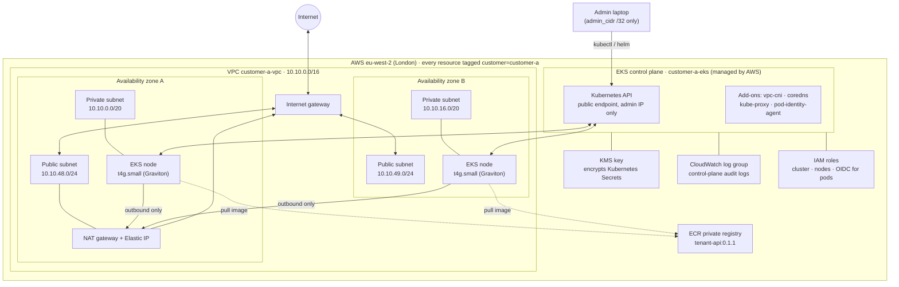

# AWS architecture (one customer)

What `terraform plan` builds for **customer-a** in `eu-west-2` (London): 56 resources from one module, `terraform/modules/customer-env`. customer-b gets an identical copy with its own network range (`10.20.0.0/16`), in its own VPC and cluster.

## Diagram

**How to read it:** the nodes live only in **private subnets**, with no public IPs. They can reach out through the NAT gateway (for example, to pull images), but nothing on the internet can reach in. The only way to manage the cluster is through its API, which accepts a single admin IP address.

## What the 56 resources are

| Group | Resources | Why it matters |
|---|---|---|
| **Network** | VPC, 2 private subnets, 2 public subnets (one of each per zone) | The customer's own isolated network. Two zones, so one data centre can fail |
| **Internet access** | Internet gateway; NAT gateway + Elastic IP | Public subnets get in and out. Private subnets get **outbound only** |
| **Routing** | Public and private route tables, routes, 4 associations | Public traffic goes to the internet gateway; private traffic goes to the NAT |
| **Locked-down defaults** | Default security group, network ACL and route table | The module takes over AWS's permissive defaults and locks them down |
| **Cluster** | EKS cluster, 4 add-ons | Kubernetes control plane, run by AWS |
| **Nodes** | Managed node group, launch template | 2 Graviton (ARM) servers, scaling from 1 to 3, private subnets only |
| **Firewalls** | Cluster and node security groups, plus about 14 rules | Only the ports the control plane and nodes need (443, kubelet, webhooks, DNS 53) |
| **Identity** | Cluster role, node role, 4 policy attachments, OIDC provider, access entry | Least privilege: nodes can **pull** from ECR but not push; pods can get their own narrow permissions; I'm the cluster admin |
| **Encryption and audit** | KMS key + alias, encryption policy, CloudWatch log group | Secrets encrypted with our own key; control-plane logs kept |

## Security choices

- **Private nodes only.** No server has a public IP.
- **API restricted to one IP.** A bank would go further and make it private-only, reached over a VPN or a private link.
- **Secrets encrypted with KMS**, and **audit logs in CloudWatch**.
- **Least-privilege IAM.** Nodes have read-only registry access.
- **Every resource tagged by customer**, so cost and ownership can be split per customer.

## Trade-offs (demo vs production)

| Demo | Production |
|---|---|
| One NAT gateway (cheaper) | One per zone, so a zone failure doesn't cut outbound traffic |
| Public API endpoint limited to one IP | Private-only endpoint |
| Terraform state on my laptop | Encrypted, locked S3 backend, one state per customer |
| 2 small nodes | Sized to load, with autoscaling |

## How it was checked

- `terraform validate`: the code is correct.
- `terraform plan`: 56 to add, 0 to change, 0 to destroy. The list is in `docs/plan-customer-a.txt`.
- **Deployed for real** on 18 October 2026: both nodes `Ready` with no external IPs, one in each zone; the Helm chart's two pods running, one per node; a live `curl` response from customer-a. See `docs/eks-proof.png`.
- **Destroyed and verified:** `Destroy complete! Resources: 56 destroyed.`, then no EKS clusters and no NAT gateways, and the ECR repository deleted. See `docs/proof/`.
- Nodes are `t4g.small` because the AWS Free plan blocks `t4g.medium` (see troubleshooting #34).
